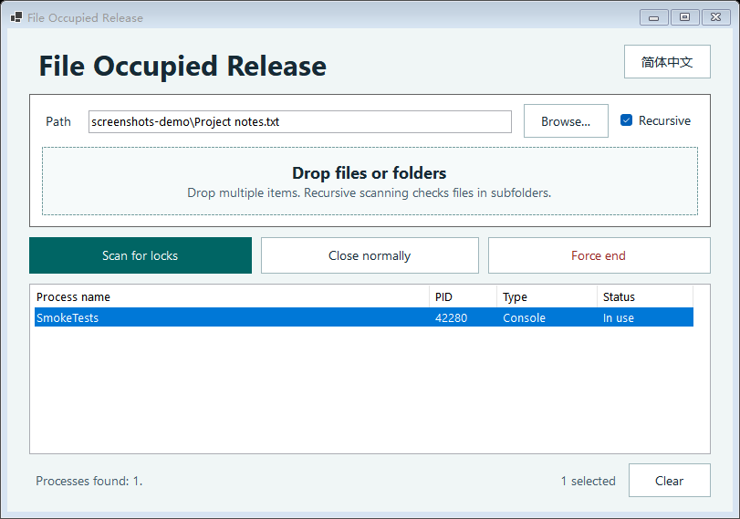

# File Occupied Release

**English** · [简体中文](README.zh-CN.md)

Find which Windows processes are using your files and close the selected application. The standalone executable runs on Windows 10/11 x64 and supports English and Simplified Chinese.

[Download the Windows EXE](https://github.com/FinnWang-CN/FileOccupiedRelease/releases/latest/download/FileOccupiedRelease.exe) · [Project website](https://fileoccupiedrelease.onepeak.cn/?lang=en)

## Screenshot



## Usage

1. Type a path, use **Browse**, or drop one or more files and folders into the window. Separate manually entered paths with `|`.
2. Click **Scan for locks**. For folders, the app checks the files they contain. Select **Recursive** to include files in subfolders.
3. Select a process and use **Close normally** to request that its application exit. **Force end** requires confirmation and may discard unsaved work.

Use the language button in the top-right corner to switch between English and Simplified Chinese.

## How it works

The WinForms app registers file paths in batches with Windows Restart Manager. It identifies each process by PID and creation time, rechecks ownership before closing a process, and refreshes the results after it exits. [Windows Restart Manager](https://learn.microsoft.com/en-us/windows/win32/rstmgr/restart-manager-portal)

Folder traversal skips reparse points. Windows Restart Manager may miss processes that hold only a directory handle or use a folder only as their working directory. The app protects system services, Windows Explorer, and critical processes from shutdown.

## Build and test

Use the .NET 8 SDK on Windows. The publish command creates a self-contained Windows x64 executable.

```powershell
dotnet run --project tests/SmokeTests.csproj -c Release
dotnet publish src/FileOccupiedRelease.csproj -c Release -r win-x64 --self-contained true -p:PublishSingleFile=true -p:IncludeNativeLibrariesForSelfExtract=true -p:EnableCompressionInSingleFile=true -p:DebugType=none -o publish
```
