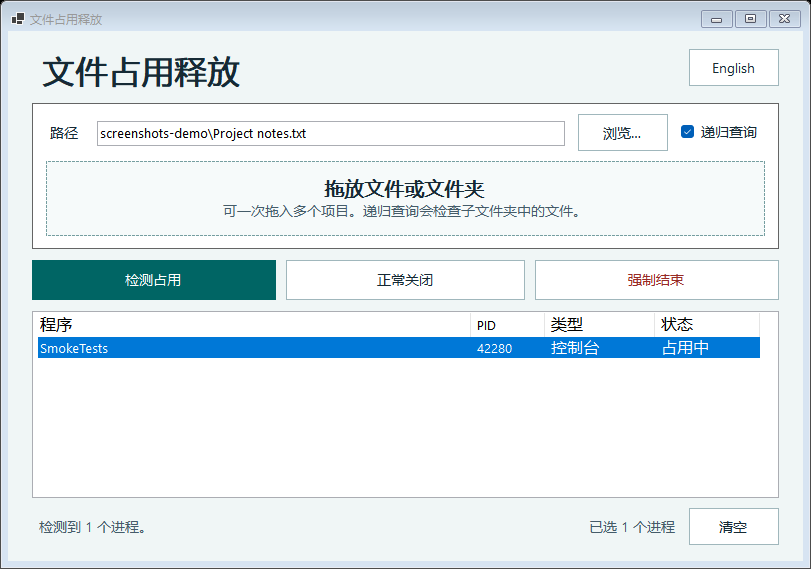

# 文件占用释放

[English](README.md) · **简体中文**

查找 Windows 中正在占用文件的进程，并关闭选中的程序。支持 Windows 10/11 x64，单文件 EXE 可以直接运行，界面支持简体中文和英文。

[下载 Windows EXE](https://github.com/FinnWang-CN/FileOccupiedRelease/releases/latest/download/FileOccupiedRelease.exe) · [项目网站](https://fileoccupiedrelease.onepeak.cn/?lang=zh)

## 软件截图



## 使用方法

1. 输入路径、通过「浏览」选择，或把一个或多个文件和文件夹拖入窗口。手动输入多个路径时用 `|` 分隔。
2. 点击「检测占用」。选择文件夹时会检查其中的文件，勾选「递归查询」可同时检查子文件夹。
3. 选择一个进程，点击「正常关闭」请求程序退出。「强制结束」需要确认，且可能丢失未保存的数据。

用右上角的语言按钮在简体中文和英文之间切换。

## 实现方式

程序使用 C# WinForms，直接调用 Windows Restart Manager 并分批注册文件路径，以 PID 和进程启动时间识别进程。关闭前会复查占用，进程退出后会自动刷新结果。 [Windows Restart Manager 文档](https://learn.microsoft.com/en-us/windows/win32/rstmgr/restart-manager-portal)

文件夹扫描会跳过重解析点。仅持有目录句柄或仅将该文件夹作为工作目录的进程可能无法检测。程序会保护系统服务、Windows 资源管理器和关键进程。

## 编译和测试

在 Windows 上使用 .NET 8 SDK。发布命令生成 Windows x64 自包含单文件 EXE。

```powershell
dotnet run --project tests/SmokeTests.csproj -c Release
dotnet publish src/FileOccupiedRelease.csproj -c Release -r win-x64 --self-contained true -p:PublishSingleFile=true -p:IncludeNativeLibrariesForSelfExtract=true -p:EnableCompressionInSingleFile=true -p:DebugType=none -o publish
```
